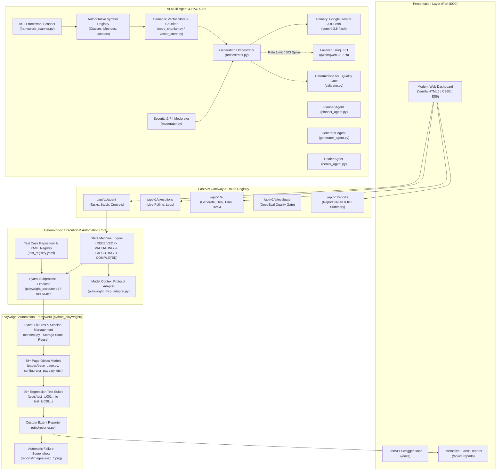
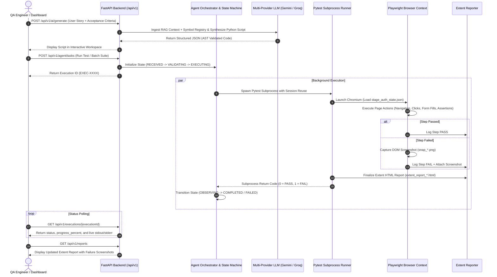
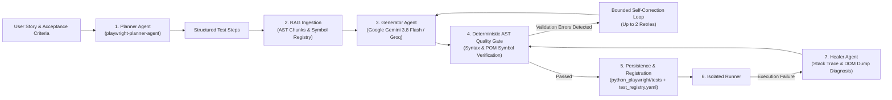

# Momentec Python Playwright Rule-Based & AI-Powered Automation Platform

[](https://www.python.org/)
[](https://playwright.dev/python/)
[](https://docs.pytest.org/)
[](https://fastapi.tiangolo.com/)
[](https://ai.google.dev/)
[](https://groq.com/)
[](http://127.0.0.1:8000/api/v1/reports)

An enterprise-grade, hybrid web automation and quality engineering platform engineered for **Momentec Brands** eCommerce applications (*Augusta Sportswear, Badger Sport, Alleson Athletic, C2 Sport*). The platform unites a **deterministic, rule-based execution engine** with an **autonomous GenAI multi-agent ecosystem** (Planning, RAG-grounded Code Generation, AST Validation, Self-Healing, and Model Context Protocol).

---

## Table of Contents

- [Platform Overview](#platform-overview)
- [Core Capabilities & Architectural Pillars](#core-capabilities--architectural-pillars)
- [System Architecture](#system-architecture)
- [Execution & Data Flow](#execution--data-flow)
- [Multi-Agent AI & RAG Pipeline](#multi-agent-ai--rag-pipeline)
- [Repository & File Structure](#repository--file-structure)
- [Playwright Test Framework & Page Object Model (POM)](#playwright-test-framework--page-object-model-pom)
- [Single-Page Web Dashboard](#single-page-web-dashboard)
- [FastAPI REST API Reference](#fastapi-rest-api-reference)
- [Environment Configuration (`.env`)](#environment-configuration-env)
- [Installation & Quickstart Guide](#installation--quickstart-guide)
- [Creating & Registering New Test Cases](#creating--registering-new-test-cases)
- [Reporting & Analytics](#reporting--analytics)
- [Troubleshooting & Best Practices](#troubleshooting--best-practices)

---

## Platform Overview

Traditional test automation platforms often suffer from high maintenance overhead, locator flakiness, and disconnected test generation tools. This platform resolves these hurdles by introducing a **Dual-Engine Architecture**:

1. **Deterministic Execution Engine**: A finite-state machine (`RECEIVED` $\rightarrow$ `VALIDATING` $\rightarrow$ `EXECUTING` $\rightarrow$ `OBSERVING` $\rightarrow$ `PASSED`/`FAILED`) running headless/headed Pytest processes with zero stochastic jitter.
2. **Autonomous GenAI Multi-Agent System**: Specialized agents powered by Google Gemini 3.8 Flash and Groq LPUs that read live Page Object Models via Abstract Syntax Tree (AST) scanning, synthesize fully grounded test scripts, and repair broken locators from runtime DOM dumps.

---

## Core Capabilities & Architectural Pillars

| Capability | Technical Implementation | Value |
| :--- | :--- | :--- |
| **Dual Execution Engines** | Pytest Subprocess Runner + Playwright Model Context Protocol (MCP) | Deterministic CI/CD runs with live agentic tracing capabilities |
| **Multi-Provider LLM Orchestrator** | Google Gemini 3.8 Flash (`gemini-3.8-flash`) with automatic fallback to Groq (`qwen/qwen3.8-27b`) and offline synthesizer | 99.9% uptime, zero vendor lock-in, and instant recovery on rate limits |
| **AST Symbol Discovery & RAG** | In-memory Vector Store indexing 38+ Page Objects, fixtures, and utilities | Guarantees generated tests reuse existing POM methods instead of hallucinating locators |
| **Deterministic Quality Gate** | AST Python syntax validator + POM symbol enforcement before code persistence | Zero runtime `ImportError` or `AttributeError` in generated test cases |
| **Autonomous Self-Healing** | Diagnostic analyzer parsing stack traces, Playwright error logs, and DOM snapshots | Automatically generates locator fixes and healed scripts |
| **Interactive Extent Reporting** | Real-time HTML report generation with step-level statuses, duration tracking, and failure screenshots | High-fidelity visibility for QA leads, developers, and stakeholders |
| **Zero-Build Web Dashboard** | Single Page Application built on Vanilla HTML5, CSS3, and modern JavaScript | Zero compilation step; immediate browser deployment from FastAPI |

---

## System Architecture



---

## Execution & Data Flow



---

## Multi-Agent AI & RAG Pipeline

The AI engine is architected around specialized roles that prevent generic code generation and strictly adhere to repository conventions:



### 1. Planner Agent (`PlannerAgent`)
- Decomposes high-level business stories and acceptance criteria into atomic user actions.
- Maps domain actions to known Momentec Page Objects (e.g., cart additions, sublimation configurator interactions, checkout shipping selections).

### 2. Generator Agent (`GeneratorAgent`)
- Converts planned test steps into full, executable pytest scripts.
- Uses `get_authenticated_context(browser_instance, env_config, state_file)` to leverage pre-authenticated browser states (`auth_state.json`) and eliminate redundant login steps.
- Directly invokes `Reporter.start_test_case()` and `Reporter.report_step()` for automated logging.

### 3. Multi-Provider LLM Orchestrator (`orchestrator.py`)
- **Primary Model**: Google Gemini 3.8 Flash (`gemini-3.8-flash`) via official Google GenAI OpenAI-compatible and native endpoints.
- **Failover Model**: Groq LPU (`qwen/qwen3.8-27b`) providing high-throughput inference if Gemini encounters rate limits or service interruptions.
- **Offline Fallback**: Deterministic script synthesizer that constructs valid test boilerplate even without active internet or API access.

### 4. Deterministic AST Validator (`validator.py`)
- Parses generated code into an Abstract Syntax Tree using Python's `ast` module.
- Verifies that all instantiated page classes and method calls exist in the `SymbolRegistry`.
- Validates the presence of required pytest fixtures, assertion statements, and reporting hooks.

### 5. Self-Healing Agent (`HealerAgent`)
- Triggered when an automated script fails execution.
- Ingests the Python traceback, Pytest failure logs, DOM dump, and screenshot path.
- Resolves locator drift (e.g., changed element IDs, updated CSS classes) and generates healed scripts without manual developer intervention.

---

## Repository & File Structure

```text
agentplaywrightpython/
├── README.md                                  # Authoritative Master Project Documentation
├── .agents/                                   # Agent Customization Root & Skill Packages
│   └── skills/
│       ├── playwright-planner-agent/SKILL.md  # Planner Agent Skill specification
│       ├── playwright-generator-agent/SKILL.md# Generator Agent Skill specification
│       └── playwright-healer-agent/SKILL.md   # Self-Healing Agent Skill specification
└── playwright-agent/                          # Application Root
    ├── .env                                   # Unified platform environment configuration
    ├── Playwright_Agent_Postman_Collection.json # Complete REST API test collection
    ├── executions/                            # Stored JSON execution snapshots & audit logs
    ├── frontend/                              # Single-Page Web Dashboard (Vanilla HTML/CSS/JS)
    │   ├── index.html                         # Dashboard layout (Generator, Workspace, Runner, Reports)
    │   ├── app.js                             # Frontend state, API integration, and log polling
    │   └── style.css                          # Custom dark-mode UI styles & animations
    └── backend/                               # FastAPI Application & Framework Engine
        ├── main.py                            # FastAPI entry point, static routes, and CORS setup
        ├── requirements.txt                   # Backend Python dependencies
        ├── agent/                             # Deterministic Execution & Rule Engine Core
        │   ├── executor/
        │   │   └── playwright_executor.py     # Subprocess runner executing Pytest batches
        │   ├── mcp/
        │   │   └── playwright_mcp_adapter.py  # Model Context Protocol browser live adapter
        │   ├── orchestrator/
        │   │   └── agent_orchestrator.py      # Execution task lifecycle & status manager
        │   ├── registry/
        │   │   ├── test_case_repository.py    # Persists AI-generated tests to disk
        │   │   └── test_registry.py           # Loads & queries YAML test registry
        │   ├── rules/
        │   │   └── rule_engine.py             # Finite State Machine transition rules & policies
        │   └── state/
        │       ├── agent_state.py             # Agent state data structures
        │       └── state_machine.py           # FSM (RECEIVED -> VALIDATING -> EXECUTING -> COMPLETED)
        ├── api/                               # REST API Endpoints & Routers
        │   └── routes/
        │       ├── agent_routes.py            # Task dispatch, batch execution, pause, terminate
        │       ├── ai_generation_routes.py    # AI Generation, Planning, Healer, RAG, AST validation
        │       ├── evaluation_routes.py       # DeepEval quality gate metrics
        │       ├── execution_routes.py        # Live execution status polling & stdout logs
        │       ├── registry_routes.py         # Symbol registry & pattern library inspection
        │       └── reports_routes.py          # Extent HTML report listing, parsing, and deletion
        ├── config/
        │   └── test_registry.yaml             # Central registry mapping test IDs to test scripts
        ├── models/                            # Pydantic Request & Response Data Models
        │   ├── execution.py                   # Execution response models
        │   └── task.py                        # Task request/response models
        ├── src/                               # AI Generation, RAG & Discovery Engine
        │   ├── agents/
        │   │   ├── generator_agent.py         # Generator agent wrapper
        │   │   ├── healer_agent.py            # Self-healing agent wrapper
        │   │   └── planner_agent.py           # Test planner agent wrapper
        │   ├── discovery/
        │   │   ├── framework_scanner.py       # AST scanner extracting POM classes & methods
        │   │   └── generate_symbol_registry.py# Standalone symbol registry generator CLI
        │   ├── execution/
        │   │   └── runner.py                  # Isolated script executor with 480s process timeout
        │   ├── generation/
        │   │   ├── orchestrator.py            # Multi-provider LLM pipeline (Gemini + Groq)
        │   │   ├── prompts.py                 # Grounded prompts & code templates
        │   │   └── validator.py               # AST validator enforcing POM compliance
        │   ├── moderation/
        │   │   └── moderator.py               # Security filters & PII data masking
        │   ├── rag/
        │   │   ├── code_chunker.py            # AST-aware code chunking strategy
        │   │   ├── embedding_client.py        # Embedding API client
        │   │   ├── ingestion_pipeline.py      # Framework directory vector indexing
        │   │   └── vector_store.py            # In-memory vector similarity store
        │   └── reports/
        │       └── extent_parser.py           # HTML Extent report scraper & KPI parser
        └── python_playwright/                 # Core Playwright Test Automation Framework
            ├── conftest.py                    # Pytest hooks, browser fixtures, storage state reuse
            ├── pytest.ini                     # Pytest configuration (reruns, timeouts, logging)
            ├── requirements.txt               # Playwright & test runner dependencies
            ├── config/
            │   ├── config.json                # Environment endpoints & user credentials
            │   ├── auth_state.json            # Reusable authenticated session cookies/tokens
            │   ├── stage_auth_state.json      # Staging session storage state
            │   └── prod_auth_state.json       # Production session storage state
            ├── pages/                         # 38+ Page Object Model Classes
            │   ├── base_page.py               # Core parent class (waits, clicks, scrolls, asserts)
            │   ├── home_page.py               # Header, banner navigation, cookie consent
            │   ├── login_page.py              # User authentication & error handling
            │   ├── pdp_page.py                # Product details, size/color grid, add to cart
            │   ├── plp_page.py                # Product catalog, facet filters, sort options
            │   ├── cart_page.py               # Cart drawer, line item management, checkout CTA
            │   ├── configurator_page.py       # Custom sublimation builder (Learn More, Style Icons)
            │   ├── custom_sublimation_page.py # Freestyle sublimation customization
            │   ├── shipping_billing_page.py   # Address entry, FedEx 2Day/Ground/Overnight selection
            │   ├── review_submit_page.py      # Order review, terms checkbox, place order CTA
            │   ├── thank_you_page.py          # Confirmation page, order number extraction
            │   ├── my_account_page.py         # Account details, order history, address book
            │   └── ...                        # Additional specialized page models
            ├── tests/                         # 29+ Pytest E2E Regression Test Suites
            │   ├── test_tc001_verify_login.py
            │   ├── test_tc014_blank_plp_validation.py
            │   ├── test_tc015_blank_pdp_validation.py
            │   ├── test_tc016_blank_order_with_fedex_2day_am.py
            │   ├── test_tc021_sublimation_order_placing.py
            │   ├── test_tc028_verify_learnmoreicon_sublimation.py
            │   ├── test_generated_tc.py       # Workspace generated test execution target
            │   └── ...
            ├── reports/                       # Generated Extent HTML reports
            │   └── images/                    # Step-level and failure screenshots (snap_*.png)
            └── utils/
                ├── reporter.py                # Interactive Extent HTML Report generator
                ├── extent_report.py           # Legacy report formatting helpers
                └── logger.py                  # Structured logging configuration
```

---

## Playwright Test Framework & Page Object Model (POM)

The automated testing layer in `backend/python_playwright` adheres strictly to industry Page Object Model design patterns:

### 1. `BasePage` Abstraction (`pages/base_page.py`)
All 38+ page objects inherit from `BasePage`, providing built-in resilience:
- Dynamic element waiting (`wait_for_selector`, `wait_for_element_visible`)
- Resilient clicks handling overlay masking (`click_element`, `js_click`)
- Form interaction helpers (`fill_text`, `select_option`, `clear_and_fill`)
- Viewport scrolling (`scroll_to_element`)
- Network stabilization (`wait_for_load_state("networkidle")`)

### 2. Session Storage State Reuse (`conftest.py`)
Rather than performing a full login through the UI before every test case (which adds 15–25 seconds of latency per run), the framework uses **Playwright Storage State**:
```python
def get_authenticated_context(browser_instance, env_config, state_filename):
    # 1. Checks if stage_auth_state.json exists and is valid
    # 2. Fast-validates presence of session cookies on the homepage
    # 3. If missing or expired, executes a clean UI login once, dumps storage_state, and returns the reusable context
```
This reduces overall test suite execution times by over **70%**.

### 3. Automatic Test Retries & Flakiness Protection (`pytest.ini`)
Configured with `pytest-rerunfailures` to automatically retry failed scenarios up to 2 times:
```ini
[pytest]
addopts = -v -s --reruns 2 --reruns-delay 1
log_cli = true
log_cli_level = INFO
```

---

## Single-Page Web Dashboard

The web interface is hosted directly by FastAPI at `http://127.0.0.1:8000/`:

```
┌────────────────────────────────────────────────────────────────────────┐
│  PW STUDIO — AI Test Platform                     ● Gemini & Groq Live │
├──────────────┬─────────────────────────────────────────────────────────┤
│ [⚡ Generator]│ 1. AI Test Generator View                               │
│ [💻 Workspace]│    • Requirement Input (User Story & Acceptance Criteria)│
│ [▶ Runner   ]│    • Model Provider Selection (Gemini 3.8 / Groq / Auto) │
│ [📊 Reports  ]│    • "Generate Test Case" triggers RAG & AST Gate       │
│              ├─────────────────────────────────────────────────────────┤
│              │ 2. Script Workspace View                                │
│              │    • Code Preview with syntax highlighting              │
│              │    • Conversational "Modify via Chat" prompt box        │
│              │    • "Validate AST" & "Save Test Case" to disk          │
│              │    • "Execute Test" in isolated subprocess              │
│              ├─────────────────────────────────────────────────────────┤
│              │ 3. Test Runner View                                     │
│              │    • Environment Switcher (Staging / Production / Dev)  │
│              │    • Engine Selector (Pytest Subprocess vs MCP Agent)   │
│              │    • Test Selection List with Search & Select-All       │
│              │    • Real-time Progress Bar & Live Stream Log Console   │
│              │    • Execution controls: Pause, Resume, Terminate       │
│              ├─────────────────────────────────────────────────────────┤
│              │ 4. Extent Reports View                                  │
│              │    • KPI Cards: Total Reports, Passed, Failed, Pass Rate│
│              │    • Report List with live iframe preview modal         │
│              │    • Single and Bulk report deletion controls           │
└──────────────┴─────────────────────────────────────────────────────────┘
```

---

## FastAPI REST API Reference

The backend provides a fully OpenAPI-compliant REST API documented via Swagger UI at `http://127.0.0.1:8000/docs`:

### 1. Test Execution & Task Management (`/api/v1/agent`)

| Method | Endpoint | Description |
| :--- | :--- | :--- |
| `GET` | `/api/v1/agent/tests` | Returns list of all registered test cases from `test_registry.yaml` |
| `POST` | `/api/v1/agent/tasks` | Spawns a single test or batch execution task |
| `POST` | `/api/v1/agent/tasks/{execution_id}/pause` | Pauses or resumes an active batch execution |
| `POST` | `/api/v1/agent/tasks/{execution_id}/terminate` | Forcibly terminates the running test subprocess |

#### Example: Triggering a Test Run
```powershell
curl -X POST "http://127.0.0.1:8000/api/v1/agent/tasks" `
  -H "Content-Type: application/json" `
  -d '{
    "action": "run_test",
    "testId": "TC028_VERIFY_LEARNMOREICON_SUBLIMATION",
    "environment": "stage",
    "engine": "PYTEST",
    "headless": false
  }'
```

---

### 2. Live Execution Status & Logs (`/api/v1/executions`)

| Method | Endpoint | Description |
| :--- | :--- | :--- |
| `GET` | `/api/v1/executions/{execution_id}` | Polls progress percentage, status (`EXECUTING`, `COMPLETED`, `FAILED`), and metrics |
| `GET` | `/api/v1/executions/{execution_id}/logs` | Retrieves live standard output (`stdout`) and error log (`stderr`) stream |

---

### 3. AI Test Generation & Self-Healing (`/api/v1/ai`)

| Method | Endpoint | Description |
| :--- | :--- | :--- |
| `POST` | `/api/v1/ai/planner/draft` | Decomposes user stories into structured test steps |
| `POST` | `/api/v1/ai/generate` | Generates a complete AST-validated Playwright Python test script |
| `POST` | `/api/v1/ai/modify` | Updates a script via conversational AI instructions |
| `POST` | `/api/v1/ai/validate` | Validates Python AST syntax and framework symbol compliance |
| `POST` | `/api/v1/ai/healer/heal` | Auto-heals broken scripts using traceback logs and DOM dumps |
| `POST` | `/api/v1/ai/save-test-case` | Persists a script to `python_playwright/tests/` and registers in YAML |
| `POST` | `/api/v1/ai/execute` | Executes a script in an isolated subprocess runner |
| `POST` | `/api/v1/ai/rag/retrieve` | Semantic vector search across Page Object Model chunks |
| `GET` | `/api/v1/ai/symbols` | Returns the entire discovered Framework Symbol Registry |

#### Example: Generating a Test Script
```powershell
curl -X POST "http://127.0.0.1:8000/api/v1/ai/generate" `
  -H "Content-Type: application/json" `
  -d '{
    "userStory": "As a buyer, I want to verify the Learn More icon on the sublimation configurator.",
    "acceptanceCriteria": [
      "Open homepage and handle cookie banner",
      "Navigate to sublimation configurator",
      "Click and verify Learn More modal is visible",
      "Close the modal"
    ],
    "environment": "stage"
  }'
```

---

### 4. Interactive Reporting (`/api/v1/reports`)

| Method | Endpoint | Description |
| :--- | :--- | :--- |
| `GET` | `/api/v1/reports` | Returns list of generated Extent HTML report files |
| `GET` | `/api/v1/reports/summary` | Returns aggregate statistics (total runs, pass rate percentage) |
| `GET` | `/api/v1/reports/{report_name}` | Serves the interactive Extent HTML report page |
| `DELETE` | `/api/v1/reports/{report_name}` | Deletes a specific HTML report |
| `DELETE` | `/api/v1/reports` | Bulk-deletes all generated reports |

---

## Environment Configuration (`.env`)

The platform centralizes all runtime configurations in `playwright-agent/backend/.env`:

```ini
# ==============================================================================
# Backend Server Configuration
# ==============================================================================
HOST=127.0.0.1
PORT=8000
ENV=stage

# ==============================================================================
# LLM & Multi-Agent Orchestrator Configuration
# ==============================================================================
# Provider options: 'auto' (preferred), 'gemini', or 'groq'
LLM_PROVIDER=auto

# Google Gemini API
GEMINI_API_KEY=your_gemini_api_key_here
GEMINI_MODEL=gemini-3.8-flash

# Groq LPU API (Failover)
GROQ_API_KEY=your_groq_api_key_here
GROQ_MODEL=qwen/qwen3.8-27b
LLM_MAX_RETRIES=2

# ==============================================================================
# Target Environments (Momentec Brands)
# ==============================================================================
STAGE_URL=https://stage.momentecbrands.com/
STAGE_USERNAME=your_stage_username
STAGE_PASSWORD=your_stage_password

PROD_URL=https://www.momentecbrands.com/
PROD_USERNAME=your_prod_username
PROD_PASSWORD=your_prod_password

DEV_URL=https://dev.momentecbrands.com/
DEV_USERNAME=your_dev_username
DEV_PASSWORD=your_dev_password

# ==============================================================================
# Test Execution Defaults
# ==============================================================================
DEFAULT_HEADLESS=false
DEFAULT_TIMEOUT=30000
```

---

## Installation & Quickstart Guide

### Prerequisites
- **Python**: Version 3.12 or higher installed.
- **Git**: For source version control.
- **Operating System**: Windows 10/11, macOS, or Linux.

### Step 1: Clone the Repository & Open Project Root
```powershell
git clone <repository_url>
cd agentplaywrightpython
```

### Step 2: Create & Activate Virtual Environment
```powershell
cd playwright-agent
python -m venv venv

# On Windows PowerShell:
.\venv\Scripts\activate

# On macOS / Linux:
source venv/bin/activate
```

### Step 3: Install Backend & Framework Dependencies
```powershell
pip install -r backend/requirements.txt
pip install -r backend/python_playwright/requirements.txt
```

### Step 4: Install Playwright Browser Binaries
```powershell
playwright install chromium
```

### Step 5: Start the FastAPI Platform Server
```powershell
cd backend
python -m uvicorn main:app --host 127.0.0.1 --port 8000 --reload
```

### Step 6: Launch the Web Dashboard
Open your browser and navigate to:
- **Web Dashboard**: [http://127.0.0.1:8000/](http://127.0.0.1:8000/)
- **Swagger API Docs**: [http://127.0.0.1:8000/docs](http://127.0.0.1:8000/docs)
- **Extent Reports**: [http://127.0.0.1:8000/api/v1/reports](http://127.0.0.1:8000/api/v1/reports)

---

## Creating & Registering New Test Cases

### 1. Adding a New Page Object (`pages/`)
Create a new Python class inheriting from `BasePage`:
```python
# backend/python_playwright/pages/example_feature_page.py
from python_playwright.pages.base_page import BasePage

class ExampleFeaturePage(BasePage):
    def __init__(self, page):
        super().__init__(page)
        self.submit_btn = "button#submit-action"

    def click_submit(self):
        self.click_element(self.submit_btn)
        return self
```

### 2. Creating a Pytest Test Suite (`tests/`)
```python
# backend/python_playwright/tests/test_tc029_example_feature.py
import pytest
from python_playwright.conftest import get_authenticated_context
from python_playwright.pages.example_feature_page import ExampleFeaturePage
from python_playwright.utils.reporter import Reporter

class TestExampleFeature:
    @pytest.fixture(autouse=True)
    def setup_class(self, browser_instance, env_config):
        self.context = get_authenticated_context(browser_instance, env_config, "stage_auth_state.json")
        self.page = self.context.new_page()
        Reporter.start_test_case("TC029 Example Feature", "Verify feature workflow")
        yield
        self.page.close()
        self.context.close()

    def test_example_workflow(self, env_config):
        self.page.goto(env_config["url"])
        feature_page = ExampleFeaturePage(self.page)
        feature_page.click_submit()
        Reporter.report_step(self.page, "Clicked Submit button", "PASS", snap=True)
```

### 3. Registering in `test_registry.yaml`
Add the test entry to `backend/config/test_registry.yaml`:
```yaml
TC029_EXAMPLE_FEATURE:
  name: "TC029 Example Feature Verification"
  type: pytest
  path: python_playwright/tests/test_tc029_example_feature.py
  enabled: true
```
The test will immediately appear in the Web Dashboard for execution and batch regression.

---

## Reporting & Analytics

Every test run automatically records execution metrics and generates a rich HTML report in `backend/python_playwright/reports/`:

- **Report Filename**: `extent_report_YYYYMMDD_HHMMSS.html`
- **Dashboard Metrics**: Total Scenarios, Passed Scenarios, Failed Scenarios, Execution Duration.
- **Visual Failure Attachments**: Failure screenshots are automatically captured and embedded into the report (`reports/images/snap_*.png`).
- **One-Click Deletion & Cleanup**: Manage disk space directly from the Dashboard or via `/api/v1/reports` endpoints.

---

## Troubleshooting & Best Practices

| Issue | Root Cause | Recommended Resolution |
| :--- | :--- | :--- |
| **`429 Rate Limit` on AI Generation** | LLM API token quota exceeded | The orchestrator automatically falls back to Groq (`qwen/qwen3.8-27b`). Ensure both `GEMINI_API_KEY` and `GROQ_API_KEY` are populated in `.env`. |
| **`Execution Timeout` after 5 minutes** | Complex sublimation builder tests or multi-tab flows exceeding standard timeout | The subprocess runner timeout is set to **480 seconds (8 minutes)** in `runner.py`. Verify that your network connection allows page assets to load within this window. |
| **Stale Session / Authentication Failure** | Expired cookies in `stage_auth_state.json` | Delete `backend/python_playwright/config/stage_auth_state.json`. On the next test run, `get_authenticated_context()` will perform a fresh UI login and regenerate the session file. |
| **Windows PowerShell Script Execution Policy** | `activate.ps1 cannot be loaded` | Run `Set-ExecutionPolicy -ExecutionPolicy RemoteSigned -Scope CurrentUser` in PowerShell before activating the virtual environment. |
| **Missing Chromium Browser Drivers** | Fresh clone without browser binaries | Run `playwright install chromium` inside the active virtual environment. |

---

## License & Team

Developed for **Momentec Brands Quality Engineering**. Engineered by **Royal Cyber Inc**. All rights reserved.
